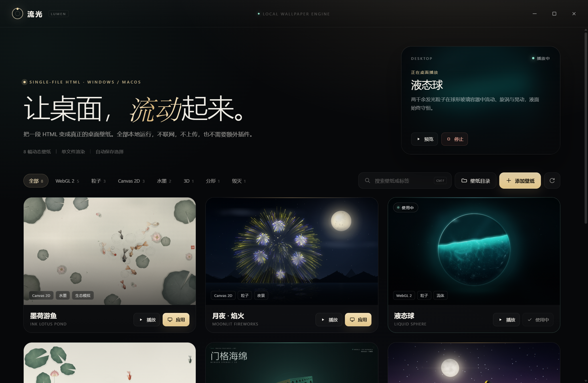
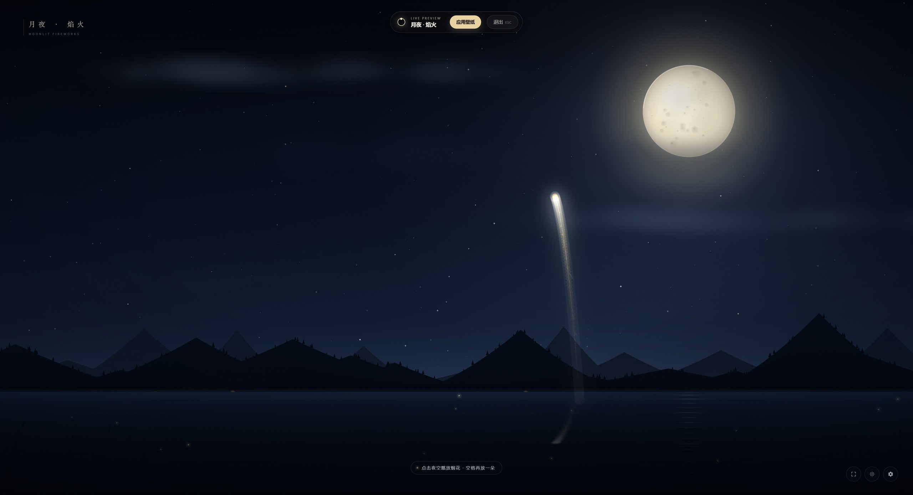
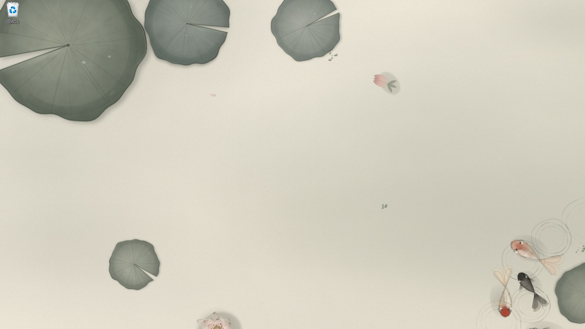
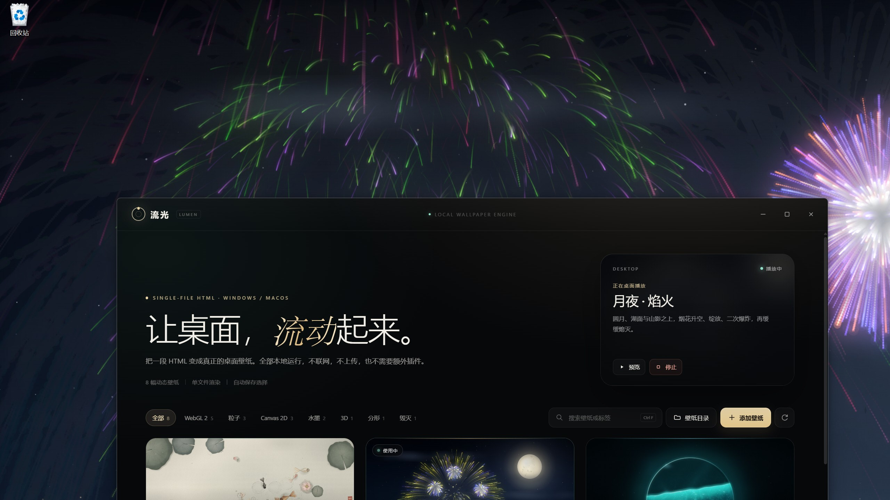
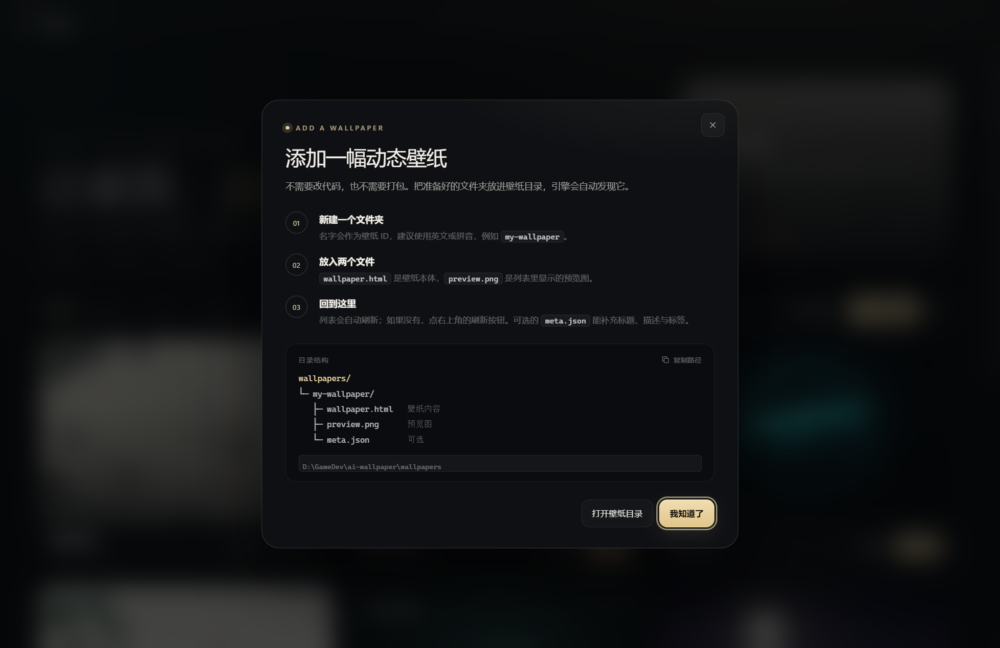

# 流光壁纸 · Lumen

一个跨平台的 **单文件 HTML 动态壁纸引擎**。在 Windows 与 macOS 上浏览、预览、应用壁纸，每个壁纸只需要一个 HTML 文件。



> 引擎本体使用 Electron 编写；Windows 的桌面壁纸渲染由原生 WebView2 宿主完成，macOS 使用 Electron 的桌面级窗口。

---

## 特性

- **壁纸库**：自动扫描壁纸目录，用 `preview.png` 生成预览，读取 HTML `<title>` 或可选的 `meta.json` 作为标题、描述与标签。
- **播放预览**：全屏打开壁纸 HTML 的真实效果，`Esc` 退出，预览悬浮条里可以直接「应用壁纸」。
- **应用到桌面**：替换系统桌面壁纸，关闭壁纸库窗口后仍会在托盘里继续播放。
- **自动发现**：往目录里新增一个文件夹，列表会自动刷新；不需要重启引擎。
- **托盘常驻**：打开壁纸库、停止动态壁纸、退出；关闭主窗口默认收进托盘。
- **记忆选择**：重启后自动恢复上一次应用的壁纸。
- **完全本地**：没有网络请求、没有上传、没有外部 CDN；壁纸 HTML 自己就是全部内容。
- **跨平台**：Windows 10/11 与 macOS。Windows 使用原生 WebView2 桌面层；macOS 使用 Electron `type: 'desktop'` 窗口。

### 播放预览



### 应用后的桌面



壁纸库只是控制面板；关闭它之后，壁纸仍会留在桌面，并在托盘里继续运行。



### 添加壁纸



---

## 快速开始

### 环境要求

- **Node.js 20+**
- **Windows 10/11 x64**：需要 Microsoft Edge WebView2 Runtime。Windows 11 通常已自带；如果没有，Windows 宿主会提示，或从 [Microsoft 官网](https://developer.microsoft.com/microsoft-edge/webview2/) 安装。
- **macOS**：Node.js 20+ 即可。

### 运行

```bash
cd ai-wallpaper
npm install
npm start
```

如果 `npm install` 时 Electron 二进制没有下载成功（网络原因），可以运行：

```bash
npm run setup:electron
```

它会从 npmmirror 镜像下载 Electron。也可以手动设置：

```powershell
$env:ELECTRON_MIRROR = "https://npmmirror.com/mirrors/electron/"
npm install
```

首次启动后，主窗口会出现在屏幕中央；点击任意壁纸的 **播放** 预览，或 **应用** 直接替换桌面。

当前工作区已经构建好 Windows 版本，也可以直接运行：

- 免安装版：`dist/Lumen Wallpaper 1.0.0.exe`
- 安装版：`dist/Lumen Wallpaper Setup 1.0.0.exe`

### macOS

macOS 的逻辑已经在代码中实现，但本项目主要在 Windows 上开发和验证；macOS 分支使用 Electron 的 `type: 'desktop'` 桌面级窗口，尚未在真机上做完整回归。若在 macOS 上遇到问题，优先查看终端输出与系统日志。

---

## 添加壁纸

在壁纸目录下新建一个文件夹：

```text
wallpapers/
└─ my-wallpaper/
   ├─ wallpaper.html   ← 必需：壁纸内容
   ├─ preview.png      ← 推荐：列表预览图（16:10 左右效果最好）
   └─ meta.json        ← 可选：标题、描述、标签
```

- 文件夹名会成为壁纸 ID，建议使用英文、数字或拼音。
- `wallpaper.html` 必须存在；`preview.png` 缺失时列表会显示占位图，但仍然可以应用。
- 列表会自动刷新；也可以点右上角的刷新按钮。
- 在壁纸库右上角点击 **壁纸目录**，会直接打开当前使用的目录。

### 壁纸目录在哪里？

| 运行方式 | 目录 |
| --- | --- |
| 开发模式（`npm start`） | 项目内的 `wallpapers/` |
| 打包后的 Windows | `%APPDATA%\Lumen Wallpaper\wallpapers` |
| 打包后的 macOS | `~/Library/Application Support/Lumen Wallpaper/wallpapers` |

打包版本首次启动时，会把内置壁纸复制到用户目录；之后新增壁纸不会覆盖已有文件夹。

### 可选的 `meta.json`

```json
{
  "title": "墨荷游鱼",
  "subtitle": "Ink Lotus Pond",
  "description": "水墨金鱼在荷塘里群游、散游，荷叶与涟漪随同一阵风轻轻摆动。",
  "tags": ["Canvas 2D", "水墨", "生态模拟"],
  "accent": "#9fc7b5",
  "order": 1
}
```

- `title` / `subtitle`：卡片标题与副标题。
- `description`：显示在「正在桌面播放」卡片里。
- `tags`：最多 6 个，会出现在卡片预览图底部，并作为筛选项。
- `accent`：卡片强调色，`#rrggbb`。
- `order`：排序值，越小越靠前；不填时按 HTML 标题的本地排序。

如果不想写 `meta.json`，引擎会从 HTML 的 `<title>` 自动提取，例如 `墨荷游鱼 · Ink Lotus Pond` 会拆成标题与副标题。

---

## 内置壁纸

这些壁纸来自本地几个 `ai-*` 工作区，已经整理为统一的 `wallpaper.html` + `preview.png` 结构：

| 目录 | 标题 | 技术 |
| --- | --- | --- |
| `ink-lotus` | 墨荷游鱼 · Ink Lotus Pond | Canvas 2D / 水墨 / Boids |
| `moonlit-fireworks` | 月夜 · 焰火 · Moonlit Fireworks | Canvas 2D / 粒子 / 夜景 |
| `liquid-sphere` | 液态球 · Liquid Sphere | WebGL 2 / 流体粒子 |
| `lotus-fish` | 荷间 · Lotus Fish | Canvas 2D / 水墨 / Boids |
| `menger-sponge` | 门格海绵 · Menger Sponge | WebGL 2 / SDF 分形 |
| `brick-hero` | 积木超人 · Brick Hero | WebGL 2 / 积木 / 夜航 |
| `ascii-rain` | 数字雨 · ASCII Rain // 3D | WebGL 2 / 3D |
| `hydrogen` | 热核 · HYDROGEN | WebGL 2 / 粒子 / 核爆 |

所有壁纸都是单文件、无外部资源、离线可用。

---

## 原理

### 应用流程

```text
Electron 主进程
  ├─ 壁纸库窗口（library）── 列表 / 搜索 / 标签筛选
  ├─ 预览窗口（preview）──── 直接加载 wallpaper.html + 悬浮操作条
  └─ 桌面壁纸
       ├─ Windows：LumenWallpaperHost.exe（C# + WebView2）
       └─ macOS：BrowserWindow({ type: 'desktop' })
```

### Windows

Windows 没有原生的 HTML 动态壁纸接口。这个引擎使用一个小的原生宿主：

1. Electron 通过 IPC 告诉主进程要应用的壁纸。
2. 主进程启动 `native/bin/LumenWallpaperHost.exe`，把 `wallpaper.html` 路径传进去。
3. 宿主创建一个无边框 WebView2 窗口，把它挂到桌面壁纸层：
   - Windows 11 24H2 及更新版本（raised desktop）：优先挂到 `Progman` 下的 `WorkerW` 壁纸层；如果该层不存在，则直接挂到 `Progman` 的 `SHELLDLL_DefView` 下方。
   - 经典 Windows 10 / 11 布局：挂到桌面图标宿主后面的 `WorkerW`。
4. 用 `SetWindowPos` 把窗口放到桌面图标下方、壁纸层上方；每 5 秒重新确认一次层级，避免被 Wallpaper Engine / Lively 等其他壁纸程序盖住。
5. 宿主退出时，下面的原始壁纸（包括 Wallpaper Engine 正在播放的内容）会重新露出来。

Windows 11 新版桌面的壁纸子树使用 DirectComposition 合成，普通的 GDI/Redirection 表面不会显示；WebView2 自带的合成路径可以正常工作，所以这里用 WebView2 而不是 Electron 的普通窗口。

### macOS

macOS 分支为每个显示器创建一个 `BrowserWindow`，使用：

```js
new BrowserWindow({ type: 'desktop', frame: false, focusable: false, ... })
```

`type: 'desktop'` 会把窗口放到 `kCGDesktopWindowLevel` 附近，从而位于桌面图标下方、普通窗口下方。窗口忽略鼠标事件，因此不会影响桌面操作。

### 为什么预览和桌面是两套窗口？

- 预览窗口是普通 Electron 窗口，负责全屏体验、`Esc` 退出和悬浮操作条。
- 桌面壁纸需要平台专属的原生层级（Windows）或桌面级窗口（macOS），因此单独管理。关闭预览不会影响已经应用的桌面壁纸。

---

## 开发

### 目录结构

```text
ai-wallpaper/
├─ src/
│  ├─ main/          Electron 主进程：扫描、配置、托盘、窗口、宿主管理
│  ├─ preload/       壁纸库 / 预览窗口的受限桥接
│  └─ renderer/      壁纸库 UI（原生 HTML/CSS/JS）
├─ native/
│  ├─ LumenWallpaperHost.cs        Windows WebView2 宿主源码
│  ├─ build-windows-host.ps1       一键编译宿主
│  └─ bin/                         已编译的 Windows 宿主 + WebView2 DLL
├─ wallpapers/       内置壁纸（每个文件夹一个壁纸）
├─ assets/           图标与托盘图标
├─ docs/screenshots/ README 截图
└─ scripts/          启动与 Electron 二进制下载辅助
```

### 常用命令

```bash
npm start          # 启动
npm run dev        # 启动（带 --dev 标记）
npm run build:host # 重新编译 Windows WebView2 宿主（Windows）
npm run build:win  # 打包 Windows（electron-builder）
npm run build:mac  # 打包 macOS（需要在 macOS 上运行）
```

`build:host` 第一次运行会从 NuGet 下载 WebView2 SDK 到 `native/webview2/`，然后编译到 `native/bin/`。仓库里已经带了编译好的宿主，直接 `npm start` 不需要这一步。

### 打包说明

- Windows 打包产物在 `dist/`，默认生成 NSIS 安装包与 portable exe。
- macOS 的 `.dmg` 必须在 macOS 上构建；`assets/icon.png` 会由 electron-builder 转换为 `.icns`。
- 打包时 `wallpapers/` 会复制到 `resources/bundled-wallpapers`，首次运行再复制到用户目录；`native/bin` 会复制到 `resources/native/bin`。
- 未签名的 exe 可能触发 SmartScreen；属于正常现象。

### 已知限制

- **Windows 多显示器**：当前桌面宿主只覆盖主显示器；macOS 会为每个显示器创建窗口。
- **macOS 真机验证**：代码路径已实现，但本仓库在 Windows 环境完成主要开发与测试；macOS 上的桌面层级、全屏 Space 行为可能因系统版本而异。
- **HDR / 动态刷新率**：没有做专门适配，按系统默认合成。
- **电池 / 全屏应用**：当前不会自动暂停壁纸渲染；可以手动在托盘中停止。

---

## 故障排查

| 问题 | 处理 |
| --- | --- |
| 点击应用后桌面没有变化 | 确认已安装 WebView2 Runtime；看终端输出；再点一次应用重试。 |
| 提示「找不到桌面壁纸宿主」 | 在项目目录运行 `npm run build:host` 重新生成 `native/bin/LumenWallpaperHost.exe`。 |
| 桌面上有其他动态壁纸 | Lumen 会覆盖在 Wallpaper Engine / Lively 上方；停止 Lumen 后会恢复原来的壁纸。 |
| 关闭窗口后找不到应用 | 应用默认收进系统托盘；点击托盘图标或再次启动 exe 即可打开。 |
| 打包后壁纸目录是空的 | 打包版本会从 `resources/bundled-wallpapers` 复制；确认 `npm run build:win` 成功并检查 `resources/`。 |
| Electron 下载失败 | `npm run setup:electron`，或设置 `ELECTRON_MIRROR` 后重新 `npm install`。 |

---

## 致谢

- 壁纸原作来自同机的 `ai-fish`、`ai-fish-gpt`、`ai-firecrake`、`ai-water`、`ai-menge`、`ai-number-rain`、`ai-nuclear` 工作区，已整理为统一结构。
- Windows 宿主基于 [WebView2](https://developer.microsoft.com/microsoft-edge/webview2/)；桌面层挂载思路参考了 Windows `WorkerW` / `Progman` 社区实践。
- 引擎使用 [Electron](https://www.electronjs.org/) 与 [electron-builder](https://www.electron.build/)。

## License

引擎代码采用 MIT License。内置壁纸的版权归各自原作者所有；如需再分发，请保留原作者的说明。


