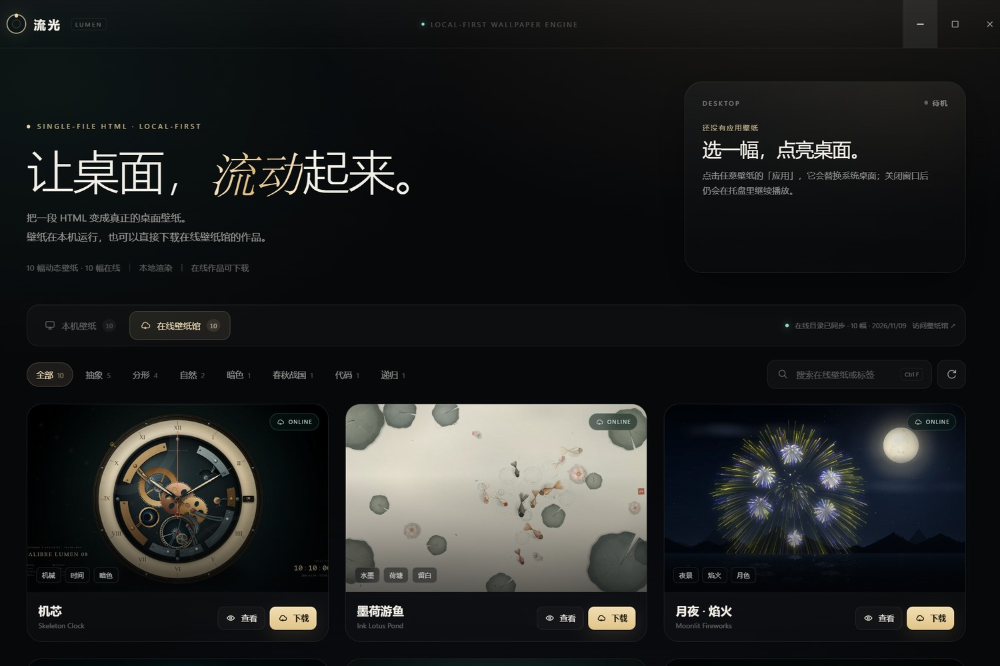

# 流光壁纸 · Lumen

一个跨平台的 **单文件 HTML 动态壁纸引擎**。在 Windows 与 macOS 上浏览、预览、应用壁纸，每个壁纸只需要一个 HTML 文件。


> 引擎本体使用 Electron 编写；Windows 的桌面壁纸渲染由原生 WebView2 宿主完成，macOS 使用 Electron 的桌面级窗口。

---

## 在线壁纸馆（GitHub Pages）

仓库里的 [`site/`](site/) 是一个独立的壁纸发布站：浏览、筛选、收藏、下载原图，以及上传投稿。前端是原生 HTML/CSS/JS，没有打包工具；唯一的一次组装发生在部署前——[`scripts/build-site.js`](scripts/build-site.js) 会把 `site/` 复制到 `_site/`，并为 `wallpapers/<id>/wallpaper.html` 生成 `live.html` 和清单里的 `live` 字段。

桌面版官方介绍与下载页也在同一个站点：[`site/app.html`](site/app.html)。它会自动读取最新 GitHub Release、显示可用的安装包，并提供仓库入口与 Star 按钮。


- 本地预览：`npm run preview:site`（先构建 `_site/`，再在 <http://127.0.0.1:4173> 启动）
- 只构建：`npm run build:site`，产物在 `_site/`（已加入 `.gitignore`）
- 部署：推送涉及 `site/`、`wallpapers/*/wallpaper.html` 或 `scripts/build-site.js` 的改动后，[`pages.yml`](.github/workflows/pages.yml) 会构建并发布 `_site/`；首次使用需在 **Settings → Pages → Source** 选择 **GitHub Actions**。
- 投稿：访客生成 ZIP 投稿包并提交 GitHub Issue；维护者可在「发布设置」中填入 Fine-grained Token 直接发布。

> 直接托管 `site/` 只能看到静图，因为 `live.html` 与 `live` 字段是构建时生成的。壁纸 HTML 在仓库里只保留 `wallpapers/<id>/wallpaper.html` 这一份；站点清单是独立策展的，新增作品仍需在 `site/data/wallpapers.json` 和 `site/assets/wallpapers/` 中补齐条目与图片。

完整说明见 [`site/README.md`](site/README.md)。

### 在引擎里浏览与下载

主窗口有「本机壁纸 / 在线壁纸馆」两个来源标签。在线标签会读取站点发布的 `data/wallpapers.json`，显示远端预览图、作者、标签和尺寸；可以直接查看大图，或下载到本机。目录缓存 5 分钟，也可以手动刷新；断网时优先回退到上一次的结果。



下载后会生成一个完全离线的壁纸文件夹：

```text
wallpapers/online-ink-lotus/
├─ wallpaper.html   ← 自动生成的全屏图片壁纸
├─ wallpaper.jpg    ← 下载的原图（扩展名跟随实际格式）
├─ preview.webp     ← 站点预览图；取不到时复制原图（扩展名跟随实际格式）
└─ meta.json        ← 标题、作者、来源与授权
```

之后它就和本机壁纸一样，可以预览、应用、在桌面播放，也可以从回收站删除。

默认站点地址是 `https://jwk000.github.io/ai-wallpaper/`。本地开发或自托管时，可以指定自己的站点根地址：

```powershell
$env:LUMEN_SITE_URL = "http://127.0.0.1:4173/"
npm start
```

> 在线标签按需联网；断网或站点尚未部署时，本地壁纸不受影响，在线区域会给出重试提示。

---

## 下载安装

当前版本 **0.1.0**；最新的公开 Release 是 **v0.1**（macOS Apple Silicon，2026-11-09，较早的构建）。Windows 安装包尚未发布。

### macOS（Apple Silicon）

下载 [`Lumen.Wallpaper-0.1.0-arm64.dmg`](https://github.com/jwk000/ai-wallpaper/releases/download/v0.1/Lumen.Wallpaper-0.1.0-arm64.dmg)，打开后把 **Lumen Wallpaper** 拖进「应用程序」。

安装包使用 ad-hoc 签名、暂未做 Apple 公证，首次打开会被 Gatekeeper 拦截。右键点击应用选择「打开」，或执行：

```bash
xattr -dr com.apple.quarantine "/Applications/Lumen Wallpaper.app"
```

> Intel / Universal 包暂未提供；如有需要，可在对应架构的 Mac 上执行 `npm run build:mac` 自行构建。

### Windows

暂未提供预编译安装包。可在 Windows 10/11 x64 上按下方「快速开始」自行构建（需要 Microsoft Edge WebView2 Runtime）。

---

## 特性

- **壁纸库**：自动扫描壁纸目录，用 `preview.png` 生成预览，读取 HTML `<title>` 或可选的 `meta.json` 作为标题、描述与标签；支持关键词搜索与标签筛选。
- **在线壁纸馆**：直接浏览托管在 GitHub Pages 上的作品，查看大图、下载到本机；目录缓存 5 分钟，支持手动刷新与断网回退，下载后自动生成可离线运行的 HTML 壁纸。
- **播放预览**：全屏打开壁纸 HTML 的真实效果，`Esc` 退出，预览悬浮条里可以直接「应用壁纸」。
- **应用到桌面**：替换系统桌面壁纸，关闭壁纸库窗口后仍会在托盘里继续播放。
- **删除壁纸**：卡片右上角的删除按钮会把壁纸文件夹移到系统回收站；删除正在播放的壁纸会先停止播放并恢复桌面。
- **自动更新**：通过 GitHub Releases 检查新版本、在后台自动下载、展示更新日志，重启后静默覆盖安装。
- **自动发现**：往目录里新增一个文件夹，列表会自动刷新；不需要重启引擎。
- **托盘常驻**：打开壁纸库、停止动态壁纸、退出；关闭主窗口默认收进托盘。
- **记忆选择**：重启后自动恢复上一次应用的壁纸。
- **本地优先**：壁纸运行时没有网络请求，已下载作品离线可用；只有「在线壁纸馆」与「检查更新」会按需访问网络。
- **屏幕保护程序**：同一份壁纸也可以打包成 macOS `.saver`，不必另外录制视频。
- **跨平台**：Windows 10/11 与 macOS。Windows 使用原生 WebView2 桌面层；macOS 使用 Electron `type: 'desktop'` 窗口。

### 播放预览


### 应用后的桌面


壁纸库只是控制面板；关闭它之后，壁纸仍会留在桌面，并在托盘里继续运行。


### 添加壁纸


---

## 快速开始

### 环境要求

- **Node.js 20+**
- **Windows 10/11 x64**：需要 Microsoft Edge WebView2 Runtime。Windows 11 通常已自带；如果没有，Windows 宿主会提示，或从 [Microsoft 官网](https://developer.microsoft.com/microsoft-edge/webview2/) 安装。
- **macOS**：Node.js 20+ 即可。

### 运行

```bash
cd ai-wallpaper
npm install
npm start
```

如果 `npm install` 时 Electron 二进制没有下载成功（网络原因），可以运行：

```bash
npm run setup:electron
```

它会从 npmmirror 镜像下载 Electron。也可以手动设置：

```powershell
$env:ELECTRON_MIRROR = "https://npmmirror.com/mirrors/electron/"
npm install
```

首次启动后，主窗口会出现在屏幕中央；点击任意壁纸的 **播放** 预览，或 **应用** 直接替换桌面。

构建完成后，Windows 产物会生成在 `dist/` 下：

- 免安装版：`dist/Lumen Wallpaper 0.1.0.exe`
- 安装版：`dist/Lumen Wallpaper Setup 0.1.0.exe`

### macOS

macOS 使用 Electron 的 `type: 'desktop'` 桌面级窗口，已在本项目的 macOS 26（Apple Silicon）环境完成打包、签名与启动验证。桌面层级、全屏 Space 与多显示器行为仍可能随系统版本变化；遇到问题请优先查看终端输出与系统日志。

构建 macOS 安装包：

```bash
npm run build:mac
```

若机器上没有 Developer ID 证书，electron-builder 会跳过签名，而 Apple Silicon 上未签名的 app 无法启动。发布前需要对 `.app` 做 ad-hoc 签名再重新封装 DMG：

```bash
codesign --force --deep --sign - "dist/mac-arm64/Lumen Wallpaper.app"
./node_modules/.bin/electron-builder --mac dmg \
  --prepackaged "dist/mac-arm64/Lumen Wallpaper.app" \
  -c.mac.identity=null
```

产物为 `dist/Lumen Wallpaper-0.1.0-arm64.dmg`。如需分发到其他机器并消除 Gatekeeper 提示，需要 Apple Developer ID 证书并完成 notarization。

---

## 添加壁纸

在壁纸目录下新建一个文件夹：

```text
wallpapers/
└─ my-wallpaper/
   ├─ wallpaper.html   ← 必需：壁纸内容
   ├─ preview.png      ← 推荐：列表预览图（也支持 .jpg / .jpeg / .webp）
   └─ meta.json        ← 可选：标题、描述、标签
```

- 文件夹名会成为壁纸 ID，建议使用英文、数字或拼音。
- `wallpaper.html` 必须存在；没有 `preview.*` 时列表会显示占位图，但仍然可以应用。
- 列表会自动刷新；也可以点右上角的刷新按钮。
- 在壁纸库右上角点击 **壁纸目录**，会直接打开当前使用的目录。

### 壁纸目录在哪里？

| 运行方式 | 目录 |
| --- | --- |
| 开发模式（`npm start`） | 项目内的 `wallpapers/` |
| 打包后的 Windows | `%APPDATA%\Lumen Wallpaper\wallpapers` |
| 打包后的 macOS | `~/Library/Application Support/Lumen Wallpaper/wallpapers` |

打包版本首次启动时，会把内置壁纸复制到用户目录；之后新增壁纸不会覆盖已有文件夹。

调试时可以用环境变量覆盖：`LUMEN_WALLPAPERS_DIR` 指定壁纸目录，`LUMEN_USER_DATA_DIR` 指定配置与缓存目录，`LUMEN_SITE_URL` 指定在线壁纸馆的站点根地址。

### 可选的 `meta.json`

```json
{
  "title": "墨荷游鱼",
  "subtitle": "Ink Lotus Pond",
  "description": "水墨金鱼在荷塘里群游、散游，荷叶与涟漪随同一阵风轻轻摆动。",
  "tags": ["Canvas 2D", "水墨", "生态模拟"],
  "accent": "#9fc7b5",
  "order": 1
}
```

- `title` / `subtitle`：卡片标题与副标题。
- `description`：显示在「正在桌面播放」卡片里。
- `tags`：最多 6 个，会出现在卡片预览图底部，并作为筛选项。
- `accent`：卡片强调色，`#rrggbb`。
- `order`：排序值，越小越靠前；不填时按 HTML 标题的本地排序。

如果不想写 `meta.json`，引擎会从 HTML 的 `<title>` 自动提取，例如 `墨荷游鱼 · Ink Lotus Pond` 会拆成标题与副标题。

### 删除壁纸

把鼠标移到任意壁纸卡片上，点击右上角的删除图标，确认后：

- 整个壁纸文件夹会被移到系统回收站，需要时可以从回收站还原。
- 如果删除的是正在桌面播放的壁纸，引擎会先停止播放并恢复原来的桌面。
- 删除内置壁纸后，下次启动不会再次自动复制回来（记录在用户配置里）。

---

## 自动更新

引擎内置基于 [electron-updater](https://www.electron.build/auto-update) 的更新器，更新源是 [GitHub Releases](https://github.com/jwk000/ai-wallpaper/releases)：

- 启动 8 秒后自动检查一次，之后每 6 小时检查一次；也可以点击页脚的「检查更新」手动检查。
- 发现新版本后自动在后台下载，页脚和更新弹窗会实时显示下载进度。
- 下载完成后点击「重启并安装」，应用会先停止桌面壁纸宿主，再静默运行 NSIS 安装包并自动重新启动，完成覆盖安装。
- 更新弹窗会展示本次 Release 的更新日志，支持 Markdown 列表、链接与代码；更新日志来自 `CHANGELOG.md`。
- 可以在更新弹窗底部关闭「启动时自动检查更新」。

**从 v0.1 升级**：v0.1 的安装包还没有内置更新器；需要用当前源码重新构建并安装一次，之后的版本才能自动更新。

**免安装版**：portable exe 不支持覆盖安装，只会检查并提示新版本，请下载安装版更新。macOS 自动更新需要签名后的 `.app` 和 zip 产物，目前主要在 Windows 上验证。

### 发布新版本

推送一个 `v*` 标签即可通过 GitHub Actions 自动构建并发布：

1. 在 `CHANGELOG.md` 中新增对应版本的小节，例如 `## [0.2.0] - 2026-12-01`。
2. 运行 `npm version minor`（或 `patch` / `major`），它会更新 `package.json` 并创建标签。
3. 推送提交和标签：`git push --follow-tags`。
4. `.github/workflows/release.yml` 会执行 `npm run build:win -- --publish always`，生成安装包、`latest.yml` 与 blockmap，并发布 GitHub Release。

> `release.yml` 目前只构建 Windows 安装包；macOS 的 dmg / zip 需要在 Mac 上按上方命令构建，再手动附加到同一个 Release。

`release-notes.md` 由 `scripts/release-notes.js` 从 `CHANGELOG.md` 生成，构建时会写进 `latest.yml` 和应用内更新弹窗。本地发布需要 `GH_TOKEN`：

```powershell
$env:GH_TOKEN = "<具有 repo 权限的 GitHub token>"
npm run release:win
```

工作流使用内置 `GITHUB_TOKEN` 与 `contents: write` 权限；打包前会校验标签与 `package.json` 版本一致。

> Release 需要包含 `latest.yml`（以及差分下载用的 blockmap），自动更新才能识别；只上传 dmg 的 Release（例如 v0.1）不会被更新器使用。
>
> 当前 `package.json` 与 `package-lock.json` 都是 `0.1.0`。发布时标签必须与 package.json 完全一致；运行 `npm version patch` / `minor` / `major` 会同时更新版本并创建对应的 `v` 标签。

---

## 内置壁纸

这些壁纸来自本地几个 `ai-*` 工作区，已经整理为统一的 `wallpaper.html` + `preview.png` 结构：

| 目录 | 标题 | 技术 |
| --- | --- | --- |
| `mechanical-clock` | 机芯 · Skeleton Clock | Canvas 2D / 陀飞轮 / 月相 / 实时时钟 |
| `ink-lotus` | 墨荷游鱼 · Ink Lotus Pond | Canvas 2D / 水墨 / Boids |
| `moonlit-fireworks` | 月夜 · 焰火 · Moonlit Fireworks | Canvas 2D / 粒子 / 夜景 |
| `liquid-sphere` | 液态球 · Liquid Sphere | WebGL 2 / 流体粒子 |
| `menger-sponge` | 门格海绵 · Menger Sponge | WebGL 2 / SDF 分形 |
| `ascii-rain` | 数字雨 · ASCII Rain // 3D | WebGL 2 / 3D |
| `hilbert-curve` | 希尔伯特曲线 · Hilbert Curve 3D | WebGL 2 / 3D / HSV / 逐段分形 |
| `nacre-mandelbrot` | 螺钿 · Nacre Mandelbrot | WebGL 2 / Mandelbrot / 无限缩放 / 贝壳纹理 |
| `koch-snowflake` | 科赫雪花 · Koch Snowflake | Canvas 2D / 递归分形 / 连续折叠 |
| `warring-states-battle` | 春秋 · 战于野 · Warring States Battlefield | Canvas 2D / 工笔长卷 / 战场模拟 |
| `parametric-jellyfish` | 水母群 · Parametric Medusozoa | Canvas 2D / 参数方程 / 无限补群 |
| `rubiks-cube` | 无限魔方 · Rubik's Cube | WebGL 2 / 实时 3D / 手绘玩具房 |

`nacre-mandelbrot` 把 Mandelbrot 边界渲染成珠母层：迭代次数生成生长纹，距离场生成浮雕与虹彩，镜头用 210 秒从全集飞入海马谷，放大到约 `1.4×10^8` 倍后以珠光淡出循环。

`koch-snowflake` 从等边三角形开始，每条边逐层折成四段；当最短折线小于一个屏幕像素后，动画再沿折痕一层层展开回三角形，约 31 秒完成一次循环。

`rubiks-cube` 用 WebGL 2 实时绘制 26 个独立小块：一连串随机外层转动把魔方打散，停顿片刻后沿相反顺序逐一还原，再开始下一轮；积木、套圈、皮球、小车和蜡笔散落在玩具房的地毯上，画面不显示任何文字。

`parametric-jellyfish` 的九只水母全部由参数曲线生成：钟形伞体、扇贝状缘膜、放射水管、马蹄形生殖腺与触手都随同一个流场呼吸、倾斜和漂移；每只个体拥有不同的轮廓、颜色、尺寸与生殖腺布局。它们会逐只游出画面，新的、不重复的个体随后从下方深海补上。

所有壁纸都是单文件、无外部资源、离线可用。

---

## macOS 屏幕保护程序

同一个壁纸还可以直接变成系统屏保，不用另外录视频。`screensaver/` 里有一个
基于 `ScreenSaver.framework` + `WKWebView` 的原生宿主，每个壁纸生成一个
`.saver`。构建需要 macOS 13+ 与 Xcode Command Line Tools：

```bash
npm run saver:install
```

然后打开 **系统设置 → 墙纸 → 屏幕保护程序…**，在列表底部选择
「流光 · 墨荷游鱼」等任意一个即可。

```bash
npm run saver        # 只构建到 screensaver/build/
npm run saver:test   # 渲染自检：逐张截图 + JS 探针
```

`saver:test` 的截图写到 `screensaver/.build/snapshots/`。

- 每个 `.saver` 内嵌一个 `wallpaper.html`，不依赖原目录，沙盒里也能加载。
- 屏保中会隐藏 HUD、操作提示和光标，只保留画面。
- 多显示器会为每块屏幕各创建一个实例；退出屏保时暂停渲染。
- 详细说明与限制见 [screensaver/README.md](screensaver/README.md)。

> 系统屏保依旧使用 macOS 的 `legacyScreenSaver` 进程加载 `.saver`；
> macOS 26 的入口在「墙纸」面板里的「屏幕保护程序…」按钮。

---

## 原理

### 应用流程

```text
Electron 主进程
  ├─ 壁纸库窗口（library）── 列表 / 搜索 / 标签筛选
  ├─ 预览窗口（preview）──── 直接加载 wallpaper.html + 悬浮操作条
  └─ 桌面壁纸
       ├─ Windows：LumenWallpaperHost.exe（C# + WebView2）
       └─ macOS：BrowserWindow({ type: 'desktop' })
```

### Windows

Windows 没有原生的 HTML 动态壁纸接口。这个引擎使用一个小的原生宿主：

1. Electron 通过 IPC 告诉主进程要应用的壁纸。
2. 主进程启动 `native/bin/LumenWallpaperHost.exe`，把 `wallpaper.html` 路径传进去。
3. 宿主创建一个无边框 WebView2 窗口，把它挂到桌面壁纸层：
   - Windows 11 24H2 及更新版本（raised desktop）：优先挂到 `Progman` 下的 `WorkerW` 壁纸层；如果该层不存在，则直接挂到 `Progman` 的 `SHELLDLL_DefView` 下方。
   - 经典 Windows 10 / 11 布局：挂到桌面图标宿主后面的 `WorkerW`。
4. 用 `SetWindowPos` 把窗口放到桌面图标下方、壁纸层上方；每 5 秒重新确认一次层级，避免被 Wallpaper Engine / Lively 等其他壁纸程序盖住。Explorer 重启导致层级变化时会自动重新挂载；宿主也会每秒检查父进程，Electron 退出后自行关闭。
5. 宿主退出时，下面的原始壁纸（包括 Wallpaper Engine 正在播放的内容）会重新露出来。

Windows 11 新版桌面的壁纸子树使用 DirectComposition 合成，普通的 GDI/Redirection 表面不会显示；WebView2 自带的合成路径可以正常工作，所以这里用 WebView2 而不是 Electron 的普通窗口。

### macOS

macOS 分支为每个显示器创建一个 `BrowserWindow`，使用：

```js
new BrowserWindow({ type: 'desktop', frame: false, focusable: false, ... })
```

`type: 'desktop'` 会把窗口放到 `kCGDesktopWindowLevel` 附近，从而位于桌面图标下方、普通窗口下方。窗口忽略鼠标事件，因此不会影响桌面操作。

### 为什么预览和桌面是两套窗口？

- 预览窗口是普通 Electron 窗口，负责全屏体验、`Esc` 退出和悬浮操作条。
- 桌面壁纸需要平台专属的原生层级（Windows）或桌面级窗口（macOS），因此单独管理。关闭预览不会影响已经应用的桌面壁纸。

---

## 开发

### 目录结构

```text
ai-wallpaper/
├─ src/
│  ├─ main/          Electron 主进程：扫描、配置、托盘、窗口、宿主、在线目录、更新器
│  ├─ preload/       壁纸库 / 预览窗口的受限桥接
│  └─ renderer/      壁纸库 UI（原生 HTML/CSS/JS）
├─ site/             GitHub Pages 壁纸馆（页面、清单、图片、投稿）
├─ native/
│  ├─ LumenWallpaperHost.cs        Windows WebView2 宿主源码
│  ├─ build-windows-host.ps1       一键编译宿主
│  └─ bin/                         已编译的 Windows 宿主 + WebView2 DLL
├─ wallpapers/       内置壁纸（每个文件夹一个壁纸）
├─ screensaver/      macOS 屏幕保护程序（ScreenSaver.framework + WKWebView）
├─ assets/           图标与托盘图标
├─ docs/screenshots/ README 截图
├─ scripts/          启动、Electron 下载、站点组装与 release notes 生成
├─ .github/workflows/
│  ├─ release.yml    标签发布工作流
│  └─ pages.yml      站点构建与 GitHub Pages 部署
├─ CHANGELOG.md      更新日志（发布时自动写入 Release）
└─ package.json      版本、electron-builder 与 GitHub publish 配置
```

### 常用命令

```bash
npm start              # 启动
npm run dev            # 启动（带 --dev 标记）
npm run setup:electron # 手动下载 Electron 二进制
npm run build:site     # 组装静态站点到 _site/
npm run preview:site   # 构建并在 4173 端口预览站点
npm run build:host     # 重新编译 Windows WebView2 宿主（Windows）
npm run build:win      # 打包 Windows（electron-builder）
npm run release:win    # 打包并发布到 GitHub Releases（需要 GH_TOKEN）
npm run release:notes  # 从 CHANGELOG.md 生成 release-notes.md
npm run build:mac      # 打包 macOS（需要在 macOS 上运行）
npm run saver          # 构建 macOS 屏保到 screensaver/build/
npm run saver:install  # 构建并安装 macOS 屏保
npm run saver:test     # 构建并运行屏保渲染自检
```

`build:host` 第一次运行会从 NuGet 下载 WebView2 SDK 到 `native/webview2/`，然后编译到 `native/bin/`。仓库里已经带了编译好的宿主，直接 `npm start` 不需要这一步。

### 打包说明

- Windows 打包产物在 `dist/`，默认生成 NSIS 安装包与 portable exe。
- 启用自动更新后，electron-builder 还会生成 `latest.yml`、`*.blockmap`，并写入 `resources/app-update.yml`；这些文件由 CI 自动上传，不要手动修改。
- macOS 的 `.dmg` / `.zip` 必须在 macOS 上构建；`assets/icon.png` 会由 electron-builder 转换为 `.icns`。macOS 自动更新还要求签名。
- 打包时 `wallpapers/` 会复制到 `resources/bundled-wallpapers`，首次运行再复制到用户目录；Windows 包还会把 `native/bin` 复制到 `resources/native/bin`。
- 未签名的 exe 可能触发 SmartScreen，属于正常现象。
- macOS 包若只做 ad-hoc 签名，首次打开需要右键「打开」或在「隐私与安全性」中放行。

### 已知限制

- **Windows 多显示器**：当前桌面宿主只覆盖主显示器；macOS 会为每个显示器创建窗口。
- **macOS 桌面层级**：已在 macOS 26 / Apple Silicon 验证打包与基本使用；桌面图标层、全屏 Space 行为可能因系统版本而异。
- **自动更新**：Windows 的 NSIS 安装版支持静默覆盖安装；portable 免安装版不支持。macOS 自动更新需要签名与 zip 产物，尚未真机验证。
- **HDR / 动态刷新率**：没有做专门适配，按系统默认合成。
- **电池 / 全屏应用**：当前不会自动暂停壁纸渲染；可以手动在托盘中停止。

---

## 故障排查

| 问题 | 处理 |
| --- | --- |
| 点击应用后桌面没有变化 | 确认已安装 WebView2 Runtime；看终端输出；再点一次应用重试。 |
| 提示「找不到桌面壁纸宿主」 | 在项目目录运行 `npm run build:host` 重新生成 `native/bin/LumenWallpaperHost.exe`。 |
| 桌面上有其他动态壁纸 | Lumen 会覆盖在 Wallpaper Engine / Lively 上方；停止 Lumen 后会恢复原来的壁纸。 |
| 关闭窗口后找不到应用 | 应用默认收进系统托盘；点击托盘图标或再次启动 exe 即可打开。 |
| 打包后壁纸目录是空的 | 打包版本会从 `resources/bundled-wallpapers` 复制；确认 `npm run build:win` 成功并检查 `resources/`。 |
| Electron 下载失败 | `npm run setup:electron`，或设置 `ELECTRON_MIRROR` 后重新 `npm install`。 |
| 检查更新提示「还没有发布可用的版本」或「更新清单缺失」 | 需要发布带 `latest.yml` 的 Release（blockmap 用于差分下载）；只上传 dmg 的 Release（如 v0.1）不参与自动更新。 |
| 更新下载完成但无法覆盖安装 | 确认使用的是 NSIS 安装版而不是 portable 免安装版；安装到只读目录时可能需要管理员权限。 |
| 删除壁纸后桌面还在播放 | 稍等目录监听刷新，或在「正在桌面播放」卡片点「停止」；文件可从系统回收站还原。 |
| 站点详情页没有「播放动效」 | 用 `npm run build:site` 构建后访问 `_site/`；直接托管 `site/` 不会生成 `live.html`。 |
| 推送后站点没有更新 | 查看 Actions 里的 **Deploy wallpaper site**；只有 `site/`、`wallpapers/*/wallpaper.html` 或 `scripts/build-site.js` 变化才会触发。 |
| 在线壁纸馆提示无法连接 | 确认 `site/` 已部署到 Pages，或设置 `LUMEN_SITE_URL` 指向实际站点根地址；刷新在线目录重试。 |
| 在线下载失败 | 检查网络和图片大小限制；下载失败不会影响已有本地壁纸。 |

---

## 致谢

- 壁纸原作来自同机的 `ai-fish`、`ai-fish-gpt`、`ai-firecrake`、`ai-water`、`ai-menge`、`ai-number-rain`、`ai-nuclear` 工作区，已整理为统一结构。
- Windows 宿主基于 [WebView2](https://developer.microsoft.com/microsoft-edge/webview2/)；桌面层挂载思路参考了 Windows `WorkerW` / `Progman` 社区实践。
- macOS 屏幕保护程序基于 `ScreenSaver.framework` 与 `WKWebView`。
- 引擎使用 [Electron](https://www.electronjs.org/) 与 [electron-builder](https://www.electron.build/)。

## License

引擎代码采用 MIT License。内置壁纸的版权归各自原作者所有；如需再分发，请保留原作者的说明。


