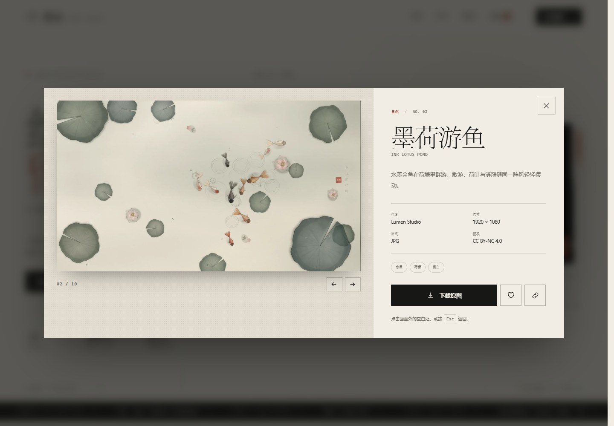

# 流光壁纸 · Lumen Archive

一个可以直接部署到 **GitHub Pages** 的壁纸发布站。它没有服务器、没有数据库，也不需要构建步骤：画廊内容是一份 JSON 清单，图片放在仓库里，上传与发布由 GitHub API 完成。




<p align="center">
  
</p>

### 桌面应用官方页

[`app.html`](app.html) 是流光壁纸桌面版的官方介绍与下载页，包含产品截图、功能说明、源码运行方式、最新 Release 检测，以及 GitHub 仓库 / Star 入口。


应用页会通过 GitHub API 读取当前 Star 数与最新 Release：有构建产物时直接换成 Windows / macOS 下载按钮；还没有 Release 时会回退到源码运行说明和 Releases 页面。

- **前台**：编辑式画廊、主题筛选、搜索、收藏、作品详情、原图下载。
- **投稿**：拖入图片，填写信息，生成一个包含原图、预览图和 `meta.json` 的 ZIP 投稿包。
- **维护者发布**：在「发布设置」中填入 Fine-grained Token，即可直接把作品与清单原子提交到仓库，GitHub Pages 随后自动部署。
- **零依赖**：原生 HTML / CSS / JavaScript，没有 CDN、外部字体或打包工具。

---

## 本地预览

浏览器的 `fetch` 不能读取 `file://` 下的 JSON，请在项目根目录启动一个本地 HTTP 服务：

```powershell
python -m http.server 4173 -d site
```

然后打开 <http://localhost:4173>。

如果使用 Node.js，也可以：

```bash
npx serve site
```

部署到 GitHub Pages 后，站点路径通常是：

```text
https://<username>.github.io/ai-wallpaper/
```

---

## 部署到 GitHub Pages

仓库里已经包含 [`.github/workflows/pages.yml`](../.github/workflows/pages.yml)，它会将 `site/` 目录发布到 Pages。

1. 提交并推送 `site/`、`.github/workflows/pages.yml` 与 `.github/ISSUE_TEMPLATE/`。
2. 打开仓库的 **Settings → Pages**。
3. 在 **Build and deployment → Source** 选择 **GitHub Actions**。
4. 向 `main` 分支推送一次，或在 **Actions → Deploy wallpaper site → Run workflow** 手动运行。
5. 部署完成后，在 Actions 的运行结果里可以看到站点地址。

之后只要 `site/` 下的文件发生变化，Pages 都会自动重新部署。上传的作品通过 GitHub API 提交到同一个分支，因此也会触发部署。

桌面引擎的「在线壁纸馆」也直接读取同一个 `data/wallpapers.json` 和图片资源；部署完成后，引擎里点开在线标签就能浏览并下载这些作品，下载时会自动生成离线 HTML 壁纸。

> 如果仓库名不是 `ai-wallpaper`，或你想换一个仓库，请修改 [`config.js`](config.js) 中的 `repo`、`branch`、`manifestPath`，以及页面里的 GitHub 链接。
> 同时记得更新 `index.html` 中 `canonical`、`og:url`、`og:image` 的绝对地址，这样社交平台才能正确抓取预览图。

### 自定义域名

1. 在 **Settings → Pages → Custom domain** 填写域名。
2. 按 GitHub 的提示配置 DNS。
3. 在 `site/` 下加入 `CNAME` 文件，内容为你的域名。

---

## 投稿与上传

### 访客模式（默认）

不需要登录。上传窗口会：

1. 在浏览器里生成 `1600px` 宽的 WebP 预览图和一张极小的模糊占位图。
2. 打包原图、预览图和 `meta.json` 为 `lumen-<id>-submission.zip`。
3. 点「在 GitHub 投稿」会打开预填了元数据的 Issue；把 ZIP 拖入 Issue 正文即可。

维护者审核后，把作品放进 `site/assets/wallpapers/<id>/`，并把对应条目加入 `site/data/wallpapers.json`，即可上线。

### 维护者模式（直接发布）

1. 打开网站底部的 **发布设置**，或上传窗口里的「设置」。
2. 创建一个 GitHub **Fine-grained personal access token**：
   - Repository access：只选择这个仓库；
   - Permissions → Contents：**Read and write**；
   - Permissions → Metadata：**Read-only**。
3. 填入 Token，点 **保存并验证**。
4. 回到上传窗口，点 **发布到 GitHub**。

Token 只存入当前标签页的 `sessionStorage`，关闭标签页即清除；它不会被写进代码、`localStorage` 或提交记录。公开站点无法替访问者保管密钥，因此这个模式只适合维护者本人使用。

发布时，站点会通过 GitHub Git Data API 一次性提交：

```text
site/assets/wallpapers/<id>/<id>-<w>x<h>.<ext>   原图
site/assets/wallpapers/<id>/preview.webp          网页预览
site/data/wallpapers.json                         作品清单
```

这是一次原子提交，不会出现图片上传成功但清单没有更新的中间状态。

---

## 内容结构

```text
site/
├─ index.html                  画廊、详情、上传与设置界面
├─ app.html                    桌面应用官方介绍与下载页
├─ styles.css                  共享样式（含响应式和 reduced-motion）
├─ app.css                     应用页专属布局
├─ config.js                   仓库与投稿配置（可公开）
├─ data/
│  └─ wallpapers.json          作品清单
├─ assets/
│  ├─ app/library.jpg          桌面应用截图
│  ├─ wallpapers/<id>/         预览 WebP + 可下载原图
│  ├─ favicon.svg
│  ├─ apple-touch-icon.png
│  └─ og-cover.jpg
├─ js/
│  ├─ app.js                   画廊、筛选、收藏、上传、ZIP 打包
│  ├─ app-page.js              应用页 Star 数、Release 与复制命令
│  ├─ github.js                GitHub Git Data API 发布
│  └─ zip.js                   零依赖 ZIP 写入器
├─ manifest.webmanifest
├─ 404.html
└─ .nojekyll
```

### 一件作品的数据

```json
{
  "id": "ink-lotus",
  "title": "墨荷游鱼",
  "subtitle": "Ink Lotus Pond",
  "description": "水墨金鱼在荷塘里群游、散游。",
  "author": "Lumen Studio",
  "category": "自然",
  "tags": ["水墨", "荷塘", "留白"],
  "license": "CC BY-NC 4.0",
  "no": "02",
  "featured": false,
  "preview": "assets/wallpapers/ink-lotus/preview.webp",
  "download": "assets/wallpapers/ink-lotus/ink-lotus-1920x1080.jpg",
  "downloadName": "lumen-ink-lotus-1920x1080.jpg",
  "width": 1920,
  "height": 1080,
  "format": "JPG",
  "bytes": 272304,
  "color": "#c9c6b7",
  "blur": "data:image/webp;base64,…",
  "createdAt": "2026-11-06"
}
```

- `preview` 用于画廊，建议宽度 1440–1600，WebP 质量 80–85。
- `download` 是原图，建议保留原始分辨率，JPG 质量 90 左右。
- `blur` 是 20–30px 的模糊图，用 data URL 内联，避免图片加载前的空白。
- `featured: true` 的作品会出现在首页主视觉。
- `category` 决定筛选分组；当前使用 自然 / 抽象 / 科幻 / 机械。

---

## 手动维护

新增一幅作品，只需：

```text
site/assets/wallpapers/my-work/
├─ my-work-2560x1600.jpg
└─ preview.webp
```

然后在 `site/data/wallpapers.json` 的 `wallpapers` 数组里加入条目。画廊会按数组顺序显示；「最新发布」会按 `createdAt` 排序。

删除作品时，同时删除目录和清单条目即可。

---

## 已知边界

- GitHub Pages 是纯静态托管，不能接收任意访客的服务端上传。公开投稿走 GitHub Issue，维护者发布走 Token，这是静态站点的取舍。
- GitHub Contents API 单文件限制较宽，但站点主动限制为 15MB，保证移动网络下的成功率。
- Token 拥有仓库写入权限，请只在自己的浏览器中使用；不要在公共电脑上保存。
- 如果 `main` 启用了分支保护，直接发布会被拒绝；此时需要允许该 Token 推送，或改用 Pull Request 流程。
- 图片版权归原作者所有。站点默认使用 CC BY-NC 4.0，上传时可以在表单里改为 CC0 或「仅限个人使用」。
