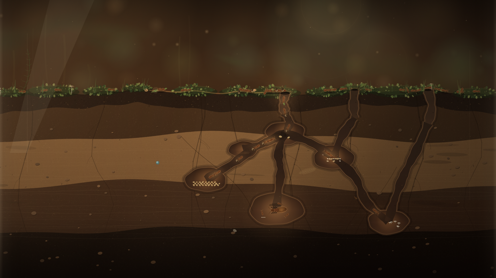

# 微观文明 · 桌面蚁园

一扇玻璃蚁园的横截面。地表是苔藓、落叶和暖光，地下是逐年挖出的隧道与巢室；工蚁用信息素在两者之间铺出一条发亮的路，把食物一点点搬进越来越深的城。

点一下地表上方投下一份食物，或者什么都不做——自动投食会让蚁园自己继续生活。阶段、储粮和蚁群数量会自动保存在本机。



## 打开

直接打开本目录的 `wallpaper.html`，或在流光壁纸的本机壁纸库中找到「微观文明 · 桌面蚁园」预览、应用。`preview.png` 是实际渲染截图。

- 点击地表上方：在该处投下一份食物；指针悬停时会出现落点环。
- 右下角「蚁园设置」：投食一份、暂停、自动投食、显示信息素、全屏、重新开始。
- `Space`：暂停 / 继续。
- `H`：隐藏 / 显示界面；开场文字约 16 秒后自动淡出。
- `F`：进入 / 退出全屏；也可按 `Esc` 退出。
- 系统启用「减少动态效果」时默认静止；在地址后添加 `?still=0` 可显式播放。

纯壁纸模式：`wallpaper.html?hud=0`。

## 蚁园规则

- **食物**：面包屑、葵花籽、叶片碎片和蜜滴，每份含 8–14 个单位。工蚁一次搬走一个单位，食物随之缩小；搬空后留下一点碎屑或糖渍。
- **信息素**：搬运中的工蚁会在地表留下气味。觅食者沿气味更浓的一侧行走；食物搬完后，气味在 1–2 分钟内淡去，路也随之消失。地表使用 512 段一维气味场，计算量很小，但足以形成真实的来回路径。
- **发现**：食物落地后若暂时没人发现，会有一只工蚁被气味吸引过去；它搬着食物返巢时留下第一条路，其他工蚁随即加入。
- **储粮与人口**：每运回一个单位，`储粮 +1`。当储粮 ≥ 4 且未达当前阶段上限时，每 14 秒左右孵出一只新工蚁并消耗 4 储粮。
- **巢穴扩建**：累计运回的食物达到阈值后，新隧道与巢室在 7 秒内被挖开；工蚁从入口进入，沿巢穴图前往粮仓、育婴室、王庭或菌圃。人口上限随阶段提高。

| 阶段 | 名称 | 累计运回 | 工蚁上限 | 新增结构 |
| --- | --- | --- | --- | --- |
| 1 | 初建 | 0 | 16 | 入口、竖井、前厅、卧廊 |
| 2 | 育婴 | 24 | 28 | 育婴室、第二入口、右侧回廊 |
| 3 | 储粮 | 56 | 40 | 粮仓、左侧回廊 |
| 4 | 王庭 | 100 | 54 | 王庭、深井、女王与侍从 |
| 5 | 菌圃 | 160 | 68 | 菌圃、第三入口、贯穿根须 |
| 6 | 深厅 | 240 | 84 | 深厅、泉滴回廊、底部砾石层 |

自动投食默认开启：地表食物少于两份时，每 55–95 秒随机落下一份。即使桌面宿主不接收鼠标，蚁园也会持续发展。

## 存档

- 键名：`lumen.ant-garden.v1`（`localStorage`）。
- 保存：每 8 秒、页面隐藏、关闭页面，以及巢穴进入新阶段时。
- 内容：种子、阶段、累计运回、当前储粮、工蚁数量、出生数、保存时间。
- 刷新页面会精确恢复累计量、人口和巢穴阶段；不做离线结算。
- 「重新开始」需要二次确认，会清除存档、换一座新蚁园，并从阶段 1 重新开始。
- 预览窗口与桌面宿主的浏览器存储可能各自独立；两边的蚁园会分别发展。这是引擎既有行为。

## URL 参数

| 参数 | 含义 |
| --- | --- |
| `hud=0` | 隐藏标题、读数和设置按钮，适合纯壁纸或截图 |
| `still=1` / `still=0` | 强制静止 / 强制播放，覆盖系统减少动态效果设置 |
| `seed=20261110` | 固定蚁园种子，复现同一套巢穴与地表细节 |
| `stage=1..6` | 演示模式：直接进入指定阶段；不读写存档 |
| `food=0..6` | 初始地表食物份数；常与演示模式一起使用 |
| `warm=40` | 首帧前预演若干秒，便于静态截图里出现路径与搬运 |
| `auto=0` | 关闭自动投食 |
| `phero=0` | 隐藏信息素 |
| `detail=0.6` | 降低土壤细节密度（0.55–1），用于低配设备 |

静态海报：`wallpaper.html?still=1&stage=5&seed=20261110&warm=40&food=3&hud=0`

固定种子的纯壁纸：`wallpaper.html?seed=20261110&hud=0&auto=0`

显式给出 `seed` 或 `stage` 会进入演示模式：不读取也不写入本机存档，方便分享与复现。去掉这些参数后，新的蚁园会写入存档。

## 实现

- 单文件 HTML + Canvas 2D，无图片、字体、音频、网络请求。
- 五张静态层缓存：空气与光斑、土壤剖面、巢穴隧道、玻璃反光、暗角；只在缩放、阶段变化或挖掘时重建。
- 地表信息素为 512 段一维场；巢穴为确定性节点图，按阶段解锁；女王、卵、幼虫、蛹、菌簇和泉滴都是程序绘制。
- 目标 30 FPS；工蚁上限 84 只，食物上限 6 份；画布像素预算约 260 万，`devicePixelRatio` 上限 1.5 并按面积回退。
- 页面隐藏时取消动画调度；恢复后重置时间戳，避免后台时间造成跳帧。
- 所有随机数来自种子化 PRNG；固定 `seed` 后，同尺寸下巢穴、地表和初始蚁群一致。

## 验证

在仓库根目录运行：

```powershell
node scripts/verify-ant.cjs
```

生成或更新实际预览图：

```powershell
node scripts/verify-ant.cjs --write-preview
```

脚本先在 Node 中模拟：横屏、竖屏、超宽屏和 4K 各 10 分钟，检查工蚁数量上限、坐标有限、储粮增长、阶段推进、人口与巢室数量、信息素范围；再检查投食、暂停、页面隐藏、减少动态效果、缩放、存档恢复、重置和演示模式。

随后用 Electron 离屏窗口加载真实 `file://` 页面，检查横屏、竖屏、超宽屏、阶段 6 与 HUD 的渲染、动画推进、点击投食、设置面板、信息素开关、重新开始、刷新后恢复、减少动态效果、窗口缩放、无网络请求和无控制台错误。截图写入系统临时目录 `lumen-ant-garden-check/`。

这些检查不等同于 Windows 原生 WebView2 桌面挂载测试；桌面宿主是否接收鼠标取决于系统与引擎版本，因此自动投食是必要保底。

设计文档见 [`docs/design/ant-garden.md`](../../docs/design/ant-garden.md)。

## 操作提示

- 想快速看到扩建：连续投食几次，然后等工蚁把食物运回巢。每次搬运都会增加累计运回量。
- 想安静地当壁纸：关掉「显示信息素」、按 `H` 隐藏界面即可；`auto=0` 可停止自动投食。
- 想重新开始：设置里点两次「重新开始」，第二次确认后生效。
