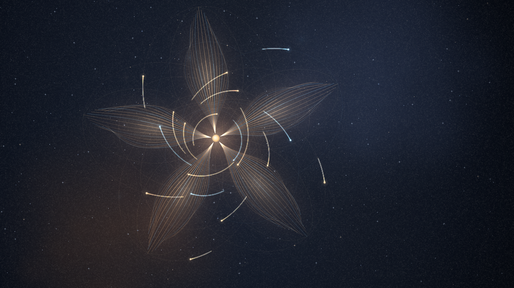

# 引力花园

深空里的一座轨道花园。十八颗天体沿各自的椭圆轨道绕中心星运行，身后拖出长曝光的光丝；光丝在几分钟里互相编织，缓慢开成一朵会呼吸的花。偶尔有彗星穿过，把花瓣拨乱，再看着它们自己收拢。

不需要操作：它会一直开着、合着、亮着。指针可以当一枚弱引力透镜，轻点可以投放一颗小行星。



## 打开

直接打开本目录的 `wallpaper.html`，或在流光壁纸的本机壁纸库中找到「引力花园」预览、应用。`preview.png` 是实际渲染截图。

- 指针移动：指针是半径 180px 的弱引力透镜，附近的光丝与天体会被轻微吸向它。
- 按住：透镜增强；松手后强度衰减，4 秒内回到静止水平。
- 轻点（不拖动）：在点击处投放一颗小行星，带切向速度进入轨道，最长 150 秒后离开。
- `Space`：暂停 / 继续。
- `H`：隐藏 / 显示界面；开场文字约 16 秒后自动淡出。
- `F`：进入 / 退出全屏；也可按 `Esc` 退出。
- 系统启用「减少动态效果」时默认静止；在地址后添加 `?still=0` 可显式播放。

纯壁纸模式：`wallpaper.html?hud=0`。

## 花园规则

- **轨道**：5 片花瓣，每片 3 颗天体共用同一花瓣朝向、不同半长轴的椭圆轨道（内 / 中 / 外）；正中外加 3 颗小半径、低偏心率的快天体，织出花蕊。一共 18 颗天体，绕中心星运行。
- **呼吸**：两组构型之间以 5 分钟为周期缓慢插值——半长轴、偏心率、花瓣张角一起变化，整朵花缓慢开合。不做整体重置。
- **光丝**：每颗天体留下一段长曝光拖尾（时间常数 8 秒，12 秒后残差约 22%，视觉上的尾巴约 12–25 秒），暖金占七成、冷青占三成；越早的段落越暗，尾端自然淡出。帧缓冲每帧只做「衰减 + 补线」，播放再久也不会越积越亮。
- **彗星**：每 90–180 秒一颗，从画面外穿过，最近时距花心 0.2–1.0 倍花半径；靠近时把花瓣向外拨开，冲量结束后弹簧把天体拉回，8 秒内收拢。
- **小行星**：点击投放，沿中心质量做速度 Verlet 积分；最多 10 颗，寿命约 110–170 秒，飞得太远或落向中心都会消失。
- **镜头**：正交俯视，画面以 0.4°/min 缓慢自转（约 15 小时一圈），叠加 ±1.5%、周期 7 分钟的呼吸式推拉。任何时刻截屏都成立。

自动彗星与自动呼吸默认开启：即使桌面宿主不接收鼠标，画面也会自己继续生长。

## URL 参数

| 参数 | 含义 |
| --- | --- |
| `hud=0` | 隐藏标题、读数和设置按钮，适合纯壁纸或截图 |
| `still=1` / `still=0` | 强制静止 / 强制播放，覆盖系统减少动态效果设置 |
| `seed=20261110` | 固定花园种子，复现同一套花瓣、星点与彗星时刻 |
| `t=95` | 起始时间（秒）；同一 `seed` 与 `t` 渲染完全相同的帧 |
| `warm=12` | 首帧前回放多少秒光丝，默认 12，最大 30 |
| `comet=0` | 关闭自动彗星 |
| `lens=0` | 关闭指针引力透镜 |
| `detail=0.6` | 降低星点与颗粒密度（0.55–1），用于低配设备 |

静态海报：`wallpaper.html?still=1&t=95&seed=20261110&hud=0`

固定种子的纯壁纸：`wallpaper.html?seed=20261110&hud=0&comet=0`

## 实现

- 单文件 HTML + Canvas 2D，无图片、字体、音频、网络请求。
- 天体位置是 `seed` 与 `t` 的纯函数：开普勒方程解椭圆轨道，焦点在花心；指针、彗星、小行星只叠加一个受弹簧约束的小位移，用 1/120s 子步长的速度 Verlet 积分，位移与速度都有上限。
- 光丝画在半分辨率加色拖尾缓冲里，每帧先按固定比例衰减、再补画这一帧走过的线段；首帧用解析轨道回放最近 12 秒，所以静止截图与运行画面一致。
- 五片花瓣各由 19 条弯曲的轨道光丝组成，另有一层羽化的暖色尘光；背景是烘焙的深空渐变、两团离焦星云与约 1650 颗确定性星点；前景有离焦光斑、尘埃划痕、暗角与确定性颗粒。
- 目标 30 FPS；实测 CPU 帧预算约 0.6–1.1 ms/帧；画布像素预算 ≤ 260 万，`devicePixelRatio` 上限 1.5 并按面积回退；天体 18 颗，小行星 ≤ 10，彗星 ≤ 2，光丝不随运行时间增长。
- 页面隐藏时取消动画调度；恢复后重置时间戳，避免后台时间造成跳帧。

## 验证

在仓库根目录运行：

```powershell
node scripts/verify-gravity.cjs
```

生成或更新实际预览图：

```powershell
node scripts/verify-gravity.cjs --write-preview
```

脚本先在 Node 中模拟：横屏、竖屏、超宽屏和 4K 各 10 分钟，检查天体数量、坐标有限、扰动与速度上限、彗星次数、光丝段数、确定性复现、5 分钟呼吸、指针透镜衰减、小行星生命周期、暂停、页面隐藏、缩放与 URL 开关。

随后用 Electron 离屏窗口加载真实 `file://` 页面，检查横屏、竖屏、超宽屏、4K 与彗星事件的渲染、亮度分布、像素级确定性、动画推进、CPU 帧预算、指针透镜、点击投放、设置面板、暂停、暂停时缩放、重新播种、减少动态效果、无网络请求和无控制台错误。截图写入系统临时目录 `lumen-gravity-garden-check/`。

要看长时间稳定性，可以再跑一次 60 分钟压力模拟：

```powershell
$env:GRAVITY_STRESS = "1"; node scripts/verify-gravity.cjs --sim-only
```

这些检查不等同于 Windows 原生 WebView2 桌面挂载测试；桌面宿主是否接收鼠标取决于系统与引擎版本，因此自动彗星与自动呼吸是必要保底。

设计文档见 [`docs/design/gravity-garden.md`](../../docs/design/gravity-garden.md)。

## 操作提示

- 想看清整朵花：按 `H` 隐藏界面，然后什么都不做，等 5 分钟的呼吸走完一轮。
- 想让花瓣动起来：把指针慢慢推过花心，光丝会跟着弯；按住会更明显。
- 想留住一帧：`?still=1&t=95&hud=0`，这一帧与预览图一致。
- 想要新的花园：设置里点两次「重新播种」，会换一个种子、重新长出一朵。
